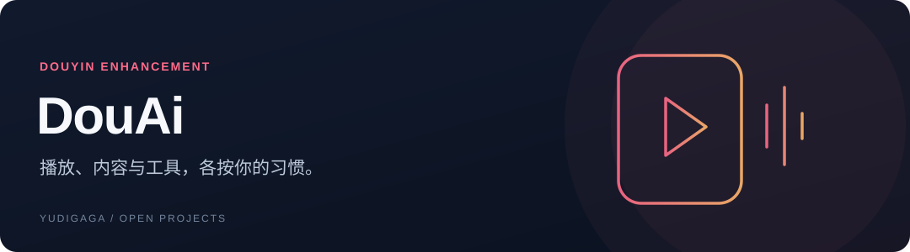
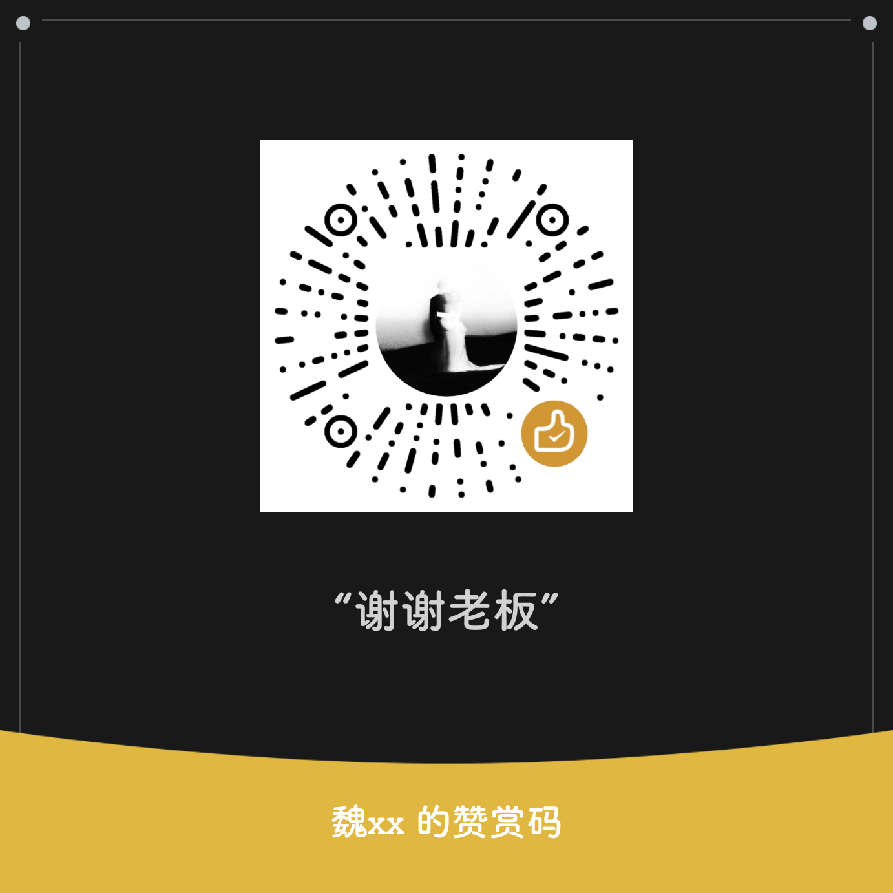

  

# DouAi

[下载正式版](https://github.com/yudigaga/DouAi/releases/latest) · [问题反馈](https://github.com/yudigaga/DouAi/issues) · [文档目录](docs/README.md)

| 播放与手势 | 内容与下载 | AI 与数据 |
| --- | --- | --- |
| 速度、书签、章节字幕搜索与画面裁切 | 内容筛选、组件设置与下载任务管理 | 模型配置、语音工具与本地分析 |

---

[☕ 请我喝杯咖啡](#赞助)

DouAi 是面向抖音的增强模块，作者 **yudigaga**，使用 libxposed API 102。

当前正式版：**0.3.1 / 202**。

[下载 APK](https://github.com/yudigaga/DouAi/releases/download/v0.3.1/DouAi-0.3.1-release.apk) · [LSPosed 下载](https://github.com/Xposed-Modules-Repo/io.github.yudigaga.douai/releases/download/202-0.3.1/DouAi-0.3.1-release.apk)

本版调整抖音 41 竖屏视频铺满后的原生边缘色带遮罩，改进侧栏与控件恢复，并完善九宫格双击点赞和导航图标。手动切页偶发短黑增加诊断。更新与验证范围见 [0.3.1 发布记录](docs/release-0.3.1.md)。

## 核心功能

- 推荐流与顶部标签筛选、组件隐藏及独立透明度调整。
- 播放手势、自动播放、播放速度、书签、章节字幕搜索、画面裁切与沉浸显示。
- 液态玻璃与重力感应（抖音 41）：导航、作者文案、进度区、右侧操作区及侧边栏可见项目随持机姿态轻微平移与倾斜，触摸时冻结，松手后平滑跟随。
- 原生和第三方下载扩展、自定义保存目录、下载任务进度与取消。
- 已加载评论查找、宿主语音转写、评论工具、系统及第三方语音、音色选择与随机音色。
- 自动回复、自动评论和续火花，支持名单范围、内容筛选及 AI 模型。
- 用户资料与聚合目录、原生用户搜索、关系筛选及群聊范围配置。
- 模型与分层提示词、素材测试、AI 消息联系人和独立对话。
- 配置导入/导出、本地数据分析与个人内容年志，支持 PNG/PDF 分享。

可用功能以当前宿主适配规则和模块设置页为准。未匹配或存在多个候选的方法不会任意选择 Hook 目标。

## 环境与适配

- Android 9 或以上。
- 支持 libxposed API 102 的 LSPosed。
- 作用域：抖音 `com.ss.android.ugc.aweme`。
- 抖音 40.6.0 / 400601。
- 抖音 40.8.0 / 400801，内部构建 40809900。
- 抖音 41.0.0 / 410001，内部构建 41009900。

同一 APK 内置上述版本的独立规则；其他版本或内部构建不保证兼容。

## 安装与使用

1. 下载正式 APK 并安装；后续正式版沿用同一签名，可覆盖更新。
2. 在 LSPosed 中启用 DouAi，作用域只选择抖音。
3. 完全退出并重新打开抖音，在抖音设置中的 DouAi 入口配置功能。

从旧 `com.douai.module` Debug 包迁移时，先卸载旧模块，再安装并启用正式包，避免重复 Hook。

模块应用提供框架连接、扫描诊断、隐藏桌面图标和关于入口。帮助也可在模块设置的“关于 → 帮助”离线查看与搜索。

使用重力感应时，在“界面相关”将“界面主题”选为“液态玻璃”，再开启“重力感应”；视频、输入与字幕保持稳定。

功能配置保存在抖音私有目录；模块应用与宿主功能配置相互独立。

## 升级与数据

当前分析数据库为 **SQLite v4**，分析备份导出为 **v3**，仍可导入旧 v1/v2 分析备份。**不要用旧版程序直接打开新版数据库。**

本地分析记录默认关闭；日常采集和计算在本机完成，主动点击请求 AI 时才发送分析摘要。

## 文档

- [文档目录](docs/README.md)：查找功能说明与历史记录。
- [完整帮助](docs/help.md)：设置入口和操作说明。
- [0.3.1 发布记录](docs/release-0.3.1.md)：本版变化、下载及验证边界。
- [构建与发布](docs/releasing.md)：构建方式、签名及发布状态。
- [个人内容年志](docs/portrait-analysis.md)：统计口径、数据与解释边界。

历史安装包见 [Releases](https://github.com/yudigaga/DouAi/releases)，历史说明保留在文档目录中。

## 赞助

如果你喜欢 DouAi，欢迎请我喝杯咖啡 ☕，感谢支持！

## 免责协议

本项目仅用于学习与技术研究。用户的应用、配置、二次开发，以及使用本项目生成、下载、发送或发布内容的行为和结果，均由用户自行决定并承担责任，与本项目及作者无关。完整责任边界见 [免责协议](DISCLAIMER.md)，APK 关于页也可查看。

## 致谢

感谢 [Miuix](https://github.com/compose-miuix-ui/miuix) 提供 UI。其他依赖与设计参考见 [第三方说明](THIRD_PARTY_NOTICES.md)。
