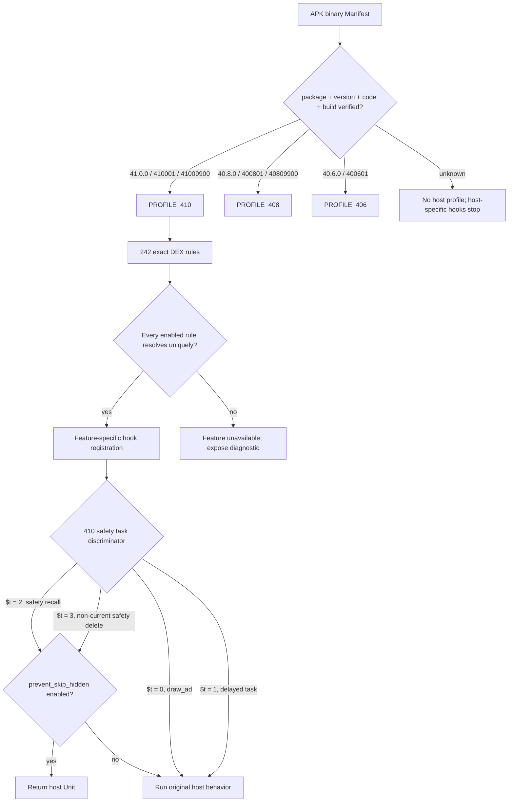

# 抖音 41.0.0 APK 逆向与 DouAi 适配报告

> 分析日期：2026-11-08
>
> 工具链：JADX 1.5.6、apktool 3.0.2、aapt2 36.0.0、dexlib2 3.0.9、Gradle 9.3.1 / JDK 21
> 范围：本地原始 APK 静态分析、模块实现和三版本回归；未发布、未安装设备、未运行真实 LSPosed Hook。

后续构建：适配阶段完成后，按用户要求生成了 **0.2.40 / 141** 本地正式签名包，其独立的最终 APK 验收及交付状态见 [0.2.40 构建记录](release-0.2.40.md)。本文保留适配阶段当时的测试范围和未构建 APK 的边界。

## 1. 执行摘要

已为 DouAi 增加独立的抖音 41.0.0 配置，身份限定为包名 `com.ss.android.ugc.aweme`、versionCode `410001`、Manifest 内部构建 `41009900`。原 40.6.0 与 40.8.0 规则和资源映射保留。新规则 242 条在目标 DEX 中全部唯一匹配；90 个语义资源在三版配置间完成 270 次正反映射核验。

41.0.0 全量本地单元测试重跑为 2,965 项、0 失败、0 错误、6 跳过；Release Lint 为 0 错误、54 警告。三份原始抖音 APK 的宿主合同专项均分别运行成功。上述结果证明本地静态合同和模块编译/测试，不证明手机上的 LSPosed 回调或真实功能操作成功。

## 2. 目标概况

| 属性 | 值 |
|---|---|
| 文件 | `抖音-41.0.0_41009900_20261102 (410001).apk` |
| 大小 | 364,363,658 bytes |
| SHA-256 | `BCA874852DD14EAAC8A38B5DC558282BA606CCE584D7AB412C3F4E42A3DBB6EF` |
| 包名 | `com.ss.android.ugc.aweme` |
| versionName / versionCode | `41.0.0 / 410001` |
| Manifest `UPDATE_VERSION_CODE` | `41009900` |
| `resources.arsc` | 12,109,168 bytes |
| DEX | 57 个，合计 467,299,888 bytes |
| `.so` 归档条目 | 269 个：`lib/arm64-v8a` 下 268 个，`assets/arm64-v8a` 下 1 个；其中 268 个为 ELF64 AArch64 |
| APK 签名证书 SHA-256 | `5182ae3b1b85337bb182cf24882449f84447ded18e296a747a9f6a0a2622512e` |

仅当上述版本与构建身份全部吻合时选择新增 Profile。没有把 APK 文件名或单独的版本字符串作为身份依据。

## 3. 范围

- Scope 文件：scope.md（本地证据：`work/adapt-41.0.0/scope.md`）。授权来自用户在 2026-11-07 指定工作区目标 APK 并要求对照反编译新增适配、保留两个旧版本。
- `in_scope`：本地反编译和资源/Dex 对照、模块适配、测试、Lint 和构建检查。
- `network_profile`：无网络发布；无设备操作。
- 导入/依赖摘要（E-IMPORTS）：APK 含 57 个 Dalvik DEX 和 269 个 `.so` 条目，其中 268 个具有 ELF64 AArch64 文件头。本次验证的 Hook 目标位于 DEX；未逐一分析 ELF 动态导入/导出，故不对 native 代码作结论。
- `work/adapt-41.0.0/` 为被 Git 忽略的本地证据目录，报告中的相关链接指向当前工作区文件，不是已发布的下载地址。

## 4. 关键适配

41.0.0 使用独立规则资产与 fingerprint `98d04bab47391942113cd56b8d187bb2ec27b083126a3b83c349b6bf9923ae55`。扫描器输出为 242 `UNIQUE`、0 `NOT_FOUND`、0 `AMBIGUOUS`，相对 40.8.0 有 97 条规则内容变化，旧资产文件未改写。身份入口见 [HostAdaptation.java](../app/src/main/java/com/douai/module/scan/HostAdaptation.java:18)，内部构建检查见 [HostApkProfile.java](../app/src/main/java/com/douai/module/scan/HostApkProfile.java:24)，新增规则见 [douyin-host-rules-41.0.0.tsv](../app/src/main/assets/douyin-host-rules-41.0.0.tsv)。

资源配置在 90 个规范 ID 上逐个对照原 41.0.0 资源表；三版共 270 次正反映射全部成功，51 项 Feed 名称保持 profile 隔离，406/408 映射输出与仓库原版本逐项相同。三份 APK 的资源哨兵只识别各自版本，混合完整 40.8/41.0 资源表会被唯一 Profile 选择器拒绝。资源映射校验结果：verification.json（本地证据：`work/adapt-41.0.0/resources/verification.json`）。

适配了原生聊天布局/反射名、相册原始路径 getter、下载菜单点击与 Aweme getter、AutoLike getter、RipsUI 输入逻辑 provider、原生实况照片编码器，以及评论图片原生保存入口。实况照片 41.0.0 使用 `X.0qS2.LIZLLL()`、`X.0UlC.gj(...)` 和 `X.1DS6` 返回对象；原有 406/408 路径仍独立存在。

隐藏视频适配按真实 switch 分支区分：41.0.0 `$t == 2` 调 `07jF.LJI` 写召回标记，`$t == 3` 直接走 `IFeedDataContext$DefaultImpls` 删除；两支都记录 `safety_check_recall`。开关开启时同时阻断 2 和 3，返回宿主 `kotlin.Unit`；`$t == 0` 是 `draw_ad`，`$t == 1` 是延迟任务，均保留原行为。分支证据：hidden-410-branches.txt（本地证据：`work/adapt-41.0.0/dex/hidden-410-branches.txt`）、目标 lambda smali（本地证据：`work/adapt-41.0.0/apktool/smali_classes43/kotlin/jvm/internal/ALambdaS43S1500000_47.smali`）。

调用方 `LX/1R0v.LIZ` 的 Smali（本地证据：`work/adapt-41.0.0/apktool/smali_classes43/X/1R0v.1.smali`） 含 key 3 的条件调度边，但该类唯一构造器将 `LIZ:IFeedContext` 固定为 null，使这种构造实例跳过对应条件块。因此该边仅作为静态结构证据，不证明实际运行可达或 Hook 已触发；分支分类依据仍是 lambda 自身的方法体。

评论上传合同也有真实变化：41.0.0 `CommentPublishRequest.LJIILLIIL` 调用四参数 `AudioUploader.LJIIIIZZ`，callback 的构造参数次序与旧版不同。新路径的 callback 对象仍以 `l0=model`、`l1=request` 保存角色，hook correlation 保持相同语义。此结论来自原始 DEX，不代表服务端接收或发布成功。

## 5. Evidence

### E-001 目标 APK 身份与归档摘要

- `source_ref`：工作区原始 APK；aapt2 binary Manifest/badging；ZIP 中 DEX 和 `.so` 项统计。
- `repro_command`：`aapt2 dump badging <host.apk>`；`aapt2 dump xmltree <host.apk> --file AndroidManifest.xml`；Python `zipfile` 枚举 `classes*.dex` 和 `lib/arm64-v8a/*.so`。
- `content_hash`：目标 APK SHA-256 `BCA874852DD14EAAC8A38B5DC558282BA606CCE584D7AB412C3F4E42A3DBB6EF`。
- `raw_excerpt`：`versionName='41.0.0' versionCode='410001'`；二进制 Manifest 的 `UPDATE_VERSION_CODE=41009900`。

### E-IMPORTS DEX 与 native 依赖盘点

- `source_ref`：原始 APK ZIP 目录；apk-inventory.json（本地证据：`work/adapt-41.0.0/apk-inventory.json`）；资源表导出（本地证据：`work/adapt-41.0.0/resources/resources.txt`）。
- `repro_command`：Python `zipfile.ZipFile` 枚举根目录 `classes*.dex` 和全部 `*.so`，汇总条目数、解压大小、ABI 目录及 ELF 文件头；`aapt2 dump resources <host.apk>`。
- `content_hash`：原始 APK SHA-256 同 E-001；归档清单 SHA-256 `5D01A9E4AD96A5B1F2590E66ACBFAEC635CF78BE91EE6E4D98646CFC3F73AF2E`；资源表导出 SHA-256 `5F2DEB46F8BCFCF99B1650E938E4BF6AA6CAB98B569750E5B28406C657B7D330`。
- `raw_excerpt`：57 DEX / 467,299,888 bytes；269 `.so` 条目，其中标准 `lib/arm64-v8a` 目录下 268 个，另有 `assets/arm64-v8a/libalog.so`。268 个条目具有 ELF64 AArch64 文件头，`lib/arm64-v8a/libsm_impl.so` 不含 ELF 文件头。`resources.arsc` 为 12,109,168 bytes。这里只盘点归档依赖和文件头，未做 ELF 动态符号、导入表或 native 调用链分析。

### E-SIGN 原始宿主 APK 签名

- `source_ref`：apk-signature.txt（本地证据：`work/adapt-41.0.0/apk-signature.txt`）。
- `repro_command`：`apksigner.bat verify --print-certs '抖音-41.0.0_41009900_20261102 (410001).apk'`。
- `content_hash`：签名验证日志 SHA-256 `A3F88EFB2DCB7C45DC52CEACF9E8857B49ED397D6A159BB1741F897E73549772`。
- `raw_excerpt`：验证退出码 0；证书 DN 为 `CN=Aweme Douyin, OU=ByteDance, O=ByteDance`；证书 SHA-256 `5182ae3b1b85337bb182cf24882449f84447ded18e296a747a9f6a0a2622512e`。日志保留 META-INF 条目未受签名保护的工具警告；此处验证的是输入宿主 APK，没有新模块 APK 的签名或对齐结论。

### E-002 DEX 解包与可读反编译

- `source_ref`：`work/adapt-41.0.0/apktool/`、`work/adapt-41.0.0/selected.dex`、`work/adapt-41.0.0/jadx-key/sources/`。
- `repro_command`：`apktool d -r -f work/adapt-41.0.0/host.apk -o work/adapt-41.0.0/apktool`；`jadx -r -j 2 -d work/adapt-41.0.0/jadx-key work/adapt-41.0.0/selected.dex`。
- `content_hash`：selected mini-DEX SHA-256 `78DB35AE40952BA61EED293C6F76B21C6001E10501A682F12A9DE49AE1CCBA8F`。
- `raw_excerpt`：apktool DEX-only 解包完整覆盖 57 个 DEX、561,650 个 Smali 文件；针对最终目标和高风险 caller 选出的 201 个类生成 201 个 JADX 源文件。JADX 报 6 个 per-class decompilation pass errors，相关 smali 仍可用作指令级证据。

### E-003 41.0.0 规则扫描

- `source_ref`：final-scan.tsv（本地证据：`work/adapt-41.0.0/dex/final-scan.tsv`）、[新规则资产](../app/src/main/assets/douyin-host-rules-41.0.0.tsv)。
- `repro_command`：`$cp=(Get-Content -Raw work/adapt-41.0.0/dex/classpath.txt).Trim(); java -Xmx768m -cp $cp DexMigration scan work/adapt-41.0.0/host.apk app/src/main/assets/douyin-host-rules-41.0.0.tsv`。
- `content_hash`：规则 SHA-256 `7FFE013B85699212EBD801594AAAB290F24523BBF9102FF7CA5F61E510F67FD6`；扫描表 SHA-256 `C1FA1EC26CE8678028FBE1161E9265D6A73461B90B07ED7FAA30F18C18A772AC`。
- `raw_excerpt`：`rules=242, unique=242, ambiguous=0, notFound=0`。

### E-004 三版资源 Profile

- `source_ref`：verification.json（本地证据：`work/adapt-41.0.0/resources/verification.json`），基于三份原 APK binary resources 与当前映射类，独立编译 Profile 进行核验。
- `repro_command`：`python work/adapt-41.0.0/resources/verify_profiles.py`。
- `content_hash`：`63BD02BA11AA4AF7AEB0B94DA2432C41383D4FAC1C1EB2C949CE81F37B506CB4`。
- `raw_excerpt`：`canonicalResourceCount=90`、`roundTripCount=270`、`legacyProfileOutputUnchangedFromHead=true`、`mixedTableDecision="reject ambiguous match"`。

### E-005 真实安全任务分支

- `source_ref`：hidden-410-branches.txt（本地证据：`work/adapt-41.0.0/dex/hidden-410-branches.txt`），源自目标 APK `classes43.dex` 的 dexlib2 packed-switch payload 和完整 invoke 指令。
- `repro_command`：在 DEX 中读取 `ALambdaS43S1500000_47.invoke()` 的 switch payload、每个 key 的相对偏移及目标基本块，确认 key 2 调 `07jF.LJI`；交叉检查 smali_classes43/kotlin/jvm/internal/ALambdaS43S1500000_47.smali（本地证据：`work/adapt-41.0.0/apktool/smali_classes43/kotlin/jvm/internal/ALambdaS43S1500000_47.smali`）。
- `content_hash`：`10879D9BD53D20B99BA9E69CBDD65B59838F6B49C9F459A6BA1D3B2228E917CE`。
- `raw_excerpt`：packed-switch keys `0..3` 分别是 draw_ad、延迟任务、安全召回标记、Feed 安全召回删除。key 2/3 均含 `safety_check_recall`；调用方 `1R0v` 的 key 3 调度边存在上下文字段恒 null 的可达性限制，未据此宣称运行时触发。

### E-006 自动化验证

- `source_ref`：完整单测日志（本地证据：`work/adapt-41.0.0/logs/full-tests-410-final.log`）、Release Lint 日志（本地证据：`work/adapt-41.0.0/logs/lint-release.log`）、完整 JUnit XML 快照（本地证据：`work/adapt-41.0.0/junit-final-410/`）、验证汇总（本地证据：`work/adapt-41.0.0/verification-summary.json`）。
- `repro_command`：`$env:DOUAI_TEST_APK=(Resolve-Path '<41.0.0 APK>').Path; .\gradlew.bat :app:testDebugUnitTest --rerun-tasks --console=plain`；` .\gradlew.bat :app:lintRelease --console=plain`。宿主专项分别将 `DOUAI_TEST_APK` 指向 40.6.0、40.8.0、41.0.0 原 APK 并重跑。
- `content_hash`：全单测日志 `5432359F0059BAE4EEF84ED46CFBE2FA2BFFBAC1BC9B509CD232470859BED1E6`；Lint 日志 `4A0C293BFBB866224B95B938B40E125A1D41BCF1D01AF726FC4B74CFECF18F1A`。
- `raw_excerpt`：41.0.0 全单测 258 suites / 2,965 tests / 0 failed / 0 errors / 6 skipped；Release Lint 0 errors / 54 warnings；三个宿主各 209 项合同测试分别强制重跑成功，最终隐藏视频分支合同也在三宿主上分别强制重跑成功；Python 工具测试 42 项通过。

## 6. Findings

### F-001 41.0.0 身份必须包含内部构建号

- `severity`：`n/a_re`
- `evidence_ids`：`[E-001, E-003]`
- `confidence`：high
- `location`：[HostAdaptation.java](../app/src/main/java/com/douai/module/scan/HostAdaptation.java:25)、[HostApkProfile.java](../app/src/main/java/com/douai/module/scan/HostApkProfile.java:24)
- `status`：validated
- `impact`：错误 versionCode、错包或非 41009900 的同版本构建不会获得 41.0.0 ruleset。

### F-002 旧版本保持独立合同

- `severity`：`n/a_re`
- `evidence_ids`：`[E-003, E-004, E-006]`
- `confidence`：high
- `location`：[HostAdaptation.java](../app/src/main/java/com/douai/module/scan/HostAdaptation.java:20)、[HostResourceProfile.java](../app/src/main/java/com/douai/module/scan/HostResourceProfile.java:1)
- `status`：validated
- `impact`：40.6/40.8 规则文件与 fingerprint 保留；原 90 项资源输出经与原仓库 HEAD 比对未变；三 APK 的宿主合同分别通过。

### F-003 41.0.0 隐藏视频召回分支与广告分支不同

- `severity`：`n/a_re`
- `evidence_ids`：`[E-005, E-006]`
- `confidence`：high
- `location`：[HostBehaviorHooks.java](../app/src/main/java/com/douai/module/feature/HostBehaviorHooks.java:64)
- `status`：validated
- `impact`：若复用旧 `$t == 0`，会拦截新包 `draw_ad` 而放过安全召回；只拦 `$t == 2` 也未覆盖 `$t == 3` 的安全召回删除方法体。Profile 专用合同现同时锁定安全分支 2/3，并保留 0/1；key 3 的实际触发仍需运行时验证。

### F-004 反射及资源名随宿主 build 变化

- `severity`：`n/a_re`
- `evidence_ids`：`[E-003, E-004, E-006]`
- `confidence`：high
- `location`：[HostResourceProfile.java](../app/src/main/java/com/douai/module/scan/HostResourceProfile.java:1)、[DownloadActionHook.java](../app/src/main/java/com/douai/module/feature/DownloadActionHook.java:347)、[OfficialLivePhotoDownload.java](../app/src/main/java/com/douai/module/feature/OfficialLivePhotoDownload.java:176)
- `status`：validated
- `impact`：已单独配置 41.0 的资源 ID、原生聊天/相册方法、下载点击与 Aweme getter、Rips 输入 provider、长按语音 bind、评论保存、点赞 ViewModel 和 live-photo encoder；不再把 40.8 名称直接套用到新包。

## 7. Callflow



### P-001 Profile selection path

- `path_type`：`callflow`
- `start`：原始 APK 文件的 binary Manifest。
- `steps`：1. 验证 package/versionCode/updateVersionCode（E-001）。 2. 选择唯一 Profile 和独立规则资产（F-001）。 3. 逐规则 DEX 唯一解析（E-003）。 4. 只注册已验证目标，未知/歧义目标保持不可用（E-006）。
- `goal`：41.0.0 使用 41009900 的 profile，406/408 行为分别按原 profile 保留。
- `residual_risks`：静态扫描和本地测试不证明真实设备上 LSPosed 拦截回调。

### P-002 安全召回路径

- `path_type`：`callflow`
- `start`：41.0.0 `ALambdaS43S1500000_47.invoke()`。
- `steps`：1. `$t` 分发（E-005）。 2. 当前项 `$t == 2` 写 recall set，非当前项 `$t == 3` 直接删除 Feed data；两条路径均属于 `safety_check_recall`。 3. 开关开启且目标规则唯一安装时拦 2/3 并返回宿主 Unit；key 0/1 和开关关闭时保留原流程（E-006）。
- `goal`：安全召回分支实际触发时，在开关开启条件下阻断其原方法体。
- `residual_risks`：`1R0v` 中的 key 3 调度边有上下文字段恒 null 的可达性限制，不证明运行时触发。真实设备通知、播放连续性和 LSPosed callback 行为未验证。

## 8. 反编译限制与遗留项

- 全 APK 的 apktool `d -r` Smali 解包完成；资源 XML 解码另用 `apktool d -s` 时在 `ResXmlSerializer.check` 因空 XML 名称抛 `NullPointerException`。4,961 个资源文件有部分生成，但该资源解码阶段不算完整成功。aapt2 对原始 binary resource table 的 41,809,950-byte 文本导出及逐项资源验证成功。
- 对整个 364 MB APK 的单进程 JADX 尝试受本机虚拟内存映射限制未完成。另用选取的 201 类生成 201 Java 文件，其中 JADX 报 6 个 per-class pass errors；涉及差异的方法以原始 DEX/smali 核验。
- 调用关系图保留 Mermaid 源码，另见 host-profile-callflow.mmd（本地证据：`work/adapt-41.0.0/host-profile-callflow.mmd`）；本机没有可用的 `mmdc` 渲染器，未生成可交付 SVG。
- Release Lint 执行成功，但本次未运行 `assembleRelease`、未产生新的模块 APK，未签发/发布新版本。
- 全测试 6 项跳过是 R8 最终 APK 专属合同；本轮未生成新 R8 APK。三份原始宿主 APK 的静态合同均单独重跑通过。
- 未执行手机安装、真机测试、LSPosed 实际 Hook 回调或服务端评论/消息验证。

## 9. Timeline

- 2026-11-07：定位 40.6.0、40.8.0 和目标 41.0.0 APK；用 binary Manifest 建立 41.0.0 精确身份负例测试。
- 2026-11-07 至 2026-11-08：完成 57-Dex Smali 和资源表盘点；以原规则首扫得到 147 唯一/95 缺失，逐项核对差异并纠正结构迁移误配，最终形成独立 242 规则并全部唯一。
- 2026-11-08：补齐版本专用资源、私信/评论/下载/隐藏视频/相册/实况照片反射合同；三宿主合同回归、全量 41 单测及 Release Lint 通过；真机边界记为未验证。

## 10. 复现

```powershell
$env:ANDROID_HOME = Join-Path $env:LOCALAPPDATA "Android/Sdk"
$env:DOUAI_TEST_APK = (Resolve-Path '抖音-41.0.0_41009900_20261102 (410001).apk').Path
.\gradlew.bat :app:testDebugUnitTest --rerun-tasks --console=plain
.\gradlew.bat :app:lintRelease --console=plain
```
